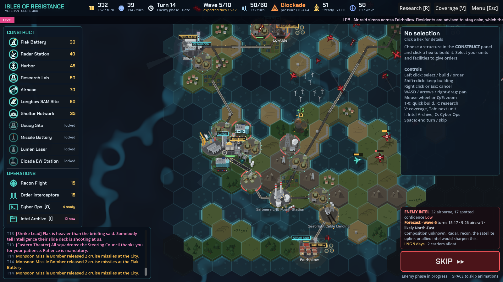
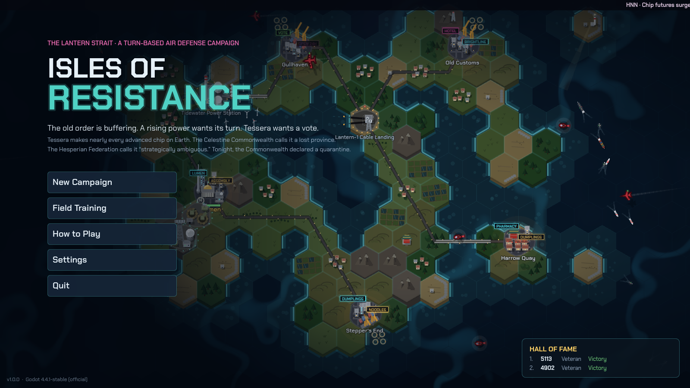
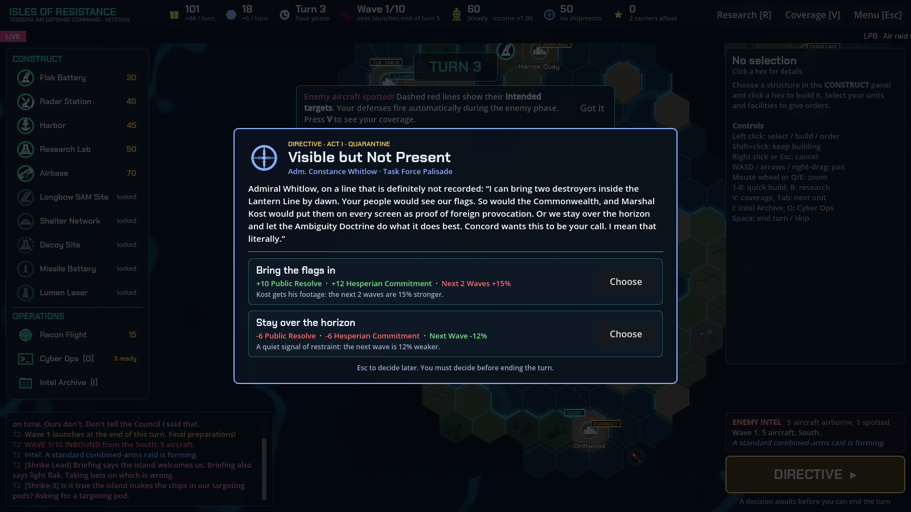
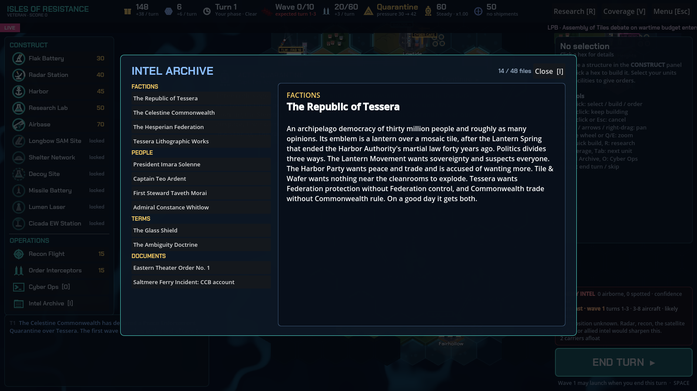
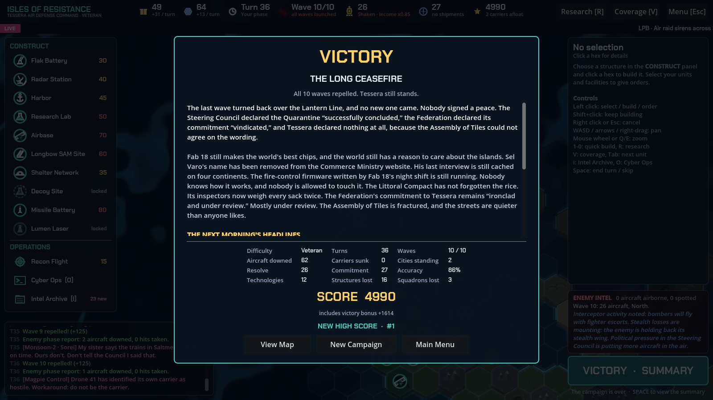
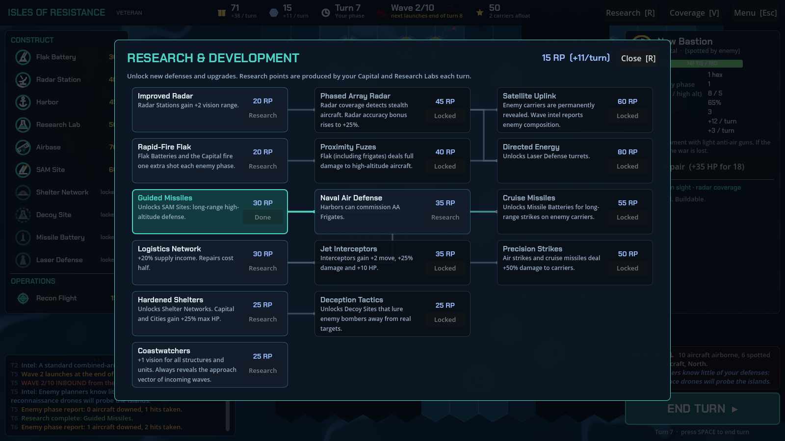
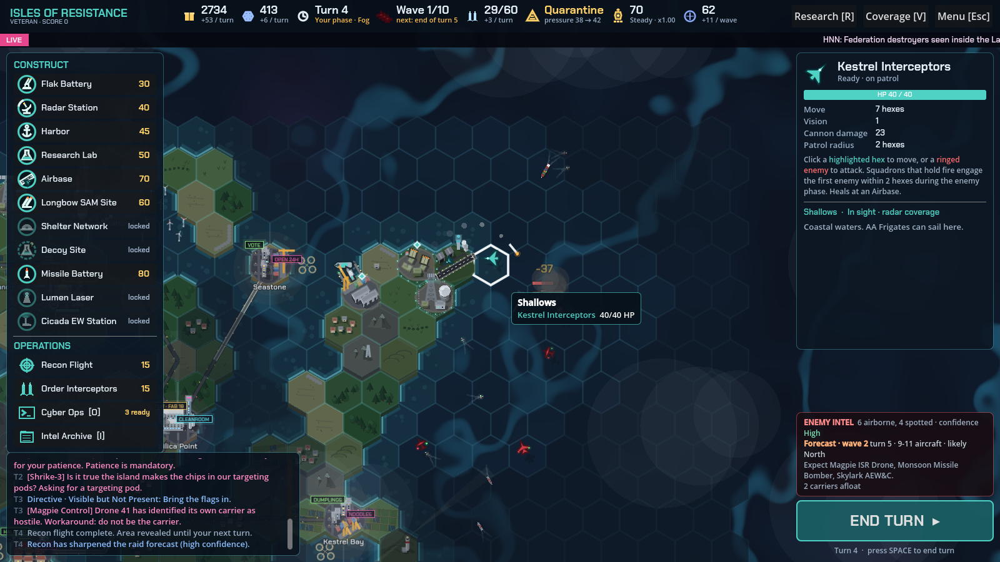

# Isles of Resistance



## Download
**Play on Windows:** grab the installer for your PC from the [latest release](https://github.com/JonathanJiWu/Isles-of-Resistance/releases/latest).

| Your PC | Installer (recommended) | No-install zip |
|---|---|---|
| **Windows 10 or 11, Intel or AMD** (most PCs) | **[IslesOfResistance-Setup-x64.exe](https://github.com/JonathanJiWu/Isles-of-Resistance/releases/latest/download/IslesOfResistance-Setup-x64.exe)** | [IslesOfResistance-Windows-x64.zip](https://github.com/JonathanJiWu/Isles-of-Resistance/releases/latest/download/IslesOfResistance-Windows-x64.zip) |
| **Windows on ARM** (Snapdragon-powered laptops and tablets, such as many Copilot+ PCs) | **[IslesOfResistance-Setup-ARM64.exe](https://github.com/JonathanJiWu/Isles-of-Resistance/releases/latest/download/IslesOfResistance-Setup-ARM64.exe)** | [IslesOfResistance-Windows-ARM64.zip](https://github.com/JonathanJiWu/Isles-of-Resistance/releases/latest/download/IslesOfResistance-Windows-ARM64.zip) |

- **Which one?** Open **Settings → System → About** and check **System type**: *x64-based processor* means x64, *ARM-based processor* means ARM64. The x64 installer warns you if it's started on an ARM PC, and the ARM64 installer refuses to install on an x64 PC.
- **The installer** sets the game up for your account only (no administrator prompt), adds Start menu and desktop shortcuts, and registers an uninstaller under **Settings → Apps**. The zip runs from any folder with no installation.
- **"Windows protected your PC"?** The builds aren't code-signed yet, so SmartScreen warns about new downloads. Click **More info → Run anyway**. Each release includes `SHA256SUMS.txt` so you can verify the files with `Get-FileHash` in PowerShell.
- **Saves, Hall of Fame and settings** live in `%APPDATA%\Isles of Resistance` and survive updates. To update, run the newer installer over the old one.
- **Requirements:** 64-bit Windows 10 or 11 and a GPU with OpenGL 3.3 or Direct3D 11. The game falls back to Direct3D 11 automatically when OpenGL isn't available, as on many ARM laptops.

On macOS or Linux, [run it from source](#installation--setup) with Godot.

## Overview
"Isles of Resistance" is a single-player turn-based defense game set in a fictional archipelago. The player defends their islands against an AI-controlled air invasion using strategic deployments on a hex-based map. The game features real-time battle animations, a research system, and an adaptive AI opponent.

The Celestine Commonwealth's carrier groups are launching wave after wave of drones, fighters, gunships, heavy bombers, cruise missiles and stealth bombers at your islands. Build air defenses, run reconnaissance, research new weapons, and decide when to strike back at the carriers themselves. Keep your Capital standing until every wave is repelled, or sink the whole fleet to end the war early. Between waves, the war's politics come to your desk.

## Setting
*A neon-lit, near-future ocean. The old order is buffering.*

The **Republic of Tessera** is a crowded, argumentative island democracy that makes nearly every advanced chip on Earth at Fab 18 in **Silica Point**. Across the Lantern Strait, the rising **Celestine Commonwealth** has climbed out of a century of humiliation and calls the islands a lost province awaiting "Recompletion". Its Steering Council has just declared a *Peace Enforcement Quarantine*. Far to the west, the **Hesperian Federation** has kept the peace, and its own pre-eminence, for eighty years under an *Ambiguity Doctrine*. It keeps Task Force Palisade "visible but not present", and it would quite like that chip factory relocated somewhere with its postal codes.

Everyone else is navigating the weather:
- the **Littoral Compact**, which trades with one side, drills with the other and insures everybody;
- **TLW**, whose CEO preaches the *Glass Shield* (nobody bombs the factory the whole world depends on);
- **Harmony Grid**, offering "Free 7G for the Island Province";
- **Halberd Dynamics**, selling lasers with a subscription firing key;
- the **Null Collective**, who leak everyone's secrets equally, in lowercase;
- and **Auntie Sol**, whose pirate radio show speaks for everyone nobody asked.

The setting draws on contemporary themes (contested sovereignty, maritime chokepoints, semiconductor supply chains, export controls, deterrence, cyber and information war) without retelling real events. No faction is simply good or evil. Commonwealth pilots are people with families, Hesperian officials have their own agenda, and Tesserans argue loudly with each other. The full world bible, covering factions, characters, history, hardware and tone rules, is in **[docs/WORLD.md](docs/WORLD.md)**.

## Features
- **Turn-based strategy.** You and the AI alternate turns. On your turn you build, research, fly your squadrons and launch operations. In the enemy phase, aircraft fly toward their targets while your defenses fire automatically.
- **Hex-based map with meaningful terrain.** Every campaign generates a new archipelago from a seed.
  - Hills give weapons +1 range.
  - Forests camouflage structures.
  - Mountains host long-range radar and force low-flying aircraft to detour.
  - Harbors must touch the coast.
  - Frigates sail the open water.
- **Fog of war.** You only see what your structures and units can see. Extend it with Radar Stations, AA Frigates, once-per-turn Recon Flights, and recon research (Improved Radar, Coastwatchers, Phased Array, Satellite Uplink). Phased Array is also what reveals stealth bombers.
- **Resource management.** Supplies come from your Capital, Cities and Harbors, and research points from your Capital and Labs. Spend them across construction, units, repairs, research and counterattacks. Losing a city cuts your income.
- **Adaptive enemy AI.** The enemy has its own fog of war: it only knows what its aircraft have seen, plus any defense that fired at them.
  - It routes around known air defenses and remembers where it took losses.
  - It shifts its approach vector between waves.
  - It re-balances each wave against your favorite weapons: low-altitude gunships against SAM networks, high bombers over flak belts, fighter escorts once interceptors appear.
  - Every wave comes with an HQ Intelligence report describing how the enemy is adapting.
- **A story that plays.** The campaign runs in four acts: *Quarantine*, *The Glass Shield*, *The Long Night* and *Terms*.
  - **Directives.** Eight political dilemmas from admirals, ministers, CEOs, hackers and back channels. Each option has explicit consequences, such as supplies, research, enemy wave strength and what the enemy knows, and each shapes the ending.
  - **Public Resolve** changes your income. **Hesperian Commitment** brings arms shipments after each repelled wave.
  - **The Glass Shield** keeps Silica Point off enemy target lists until some decision cracks it.
  - **Cyber Ops** spend research on hacks such as *Null Pointer*, *Rubber Duck*, *Merge Conflict* and *Rollback*.
  - **A live news ticker** shows Commonwealth state media, Hesperian cable news, Lumen public radio, pirate radio and advertisers telling the same war differently.
  - **Intercepted pilot chatter** plays during battles, and the **Intel Archive** collects dossiers and contradictory documents.
  - **Epilogues** depend on how the war ended and what you traded to end it.
- **Research system.** A 15-technology tree unlocks Longbow SAM Sites, Shelter Networks, Decoy Sites, Lantern-class corvettes, Missile Batteries and Lumen Lasers, plus many upgrades.
- **Counterattacks.** Find the carriers hiding in the eastern sea, then hit them with Air Strikes from Airbases or Cruise Missiles from Missile Batteries. Every carrier sunk shrinks future waves.
- **Real-time battle animations.** Flak bursts, SAM trails, laser beams, dogfights, falling bombs, explosions and screen shake play out during the enemy phase. Skip them at any time with <kbd>Space</kbd>, speed them up, or turn them off in Settings.
- **Neon night look.** Night-graded terrain, glowing coastlines, flickering city signage, searchlights over Lumen and Silica Point, and blinking navigation lights.
- **Polish.** Animated title screen, four difficulty levels with an even ramp, autosave and Continue, a Hall of Fame, tutorial hints, an in-game How to Play guide, and settings for audio, animation speed and display.
- **Music and sound.** Three procedurally composed music cues (title theme, a calm planning track and a driving battle track that crossfades in during the enemy phase) plus synthesized sound effects. The music is rendered on background threads on first launch and cached.
- **No external assets.** All art is procedural vector drawing and every sound is synthesized in code. The only bundled asset is the [Chakra Petch](https://fonts.google.com/specimen/Chakra+Petch) font (SIL OFL).

| | |
|---|---|
|  |  |
|  |  |
|  |  |

## How to Play
1. **Build.** Pick a structure in the **CONSTRUCT** panel (or press <kbd>1</kbd>–<kbd>0</kbd>) and click a hex. Hover a button to see its stats, and hold <kbd>Shift</kbd> to place several.
2. **Mind the altitude.** Flak shreds *low* flyers (drones, gunships, cruise missiles) but barely scratches *high* bombers. SAM Sites are the opposite, and Lasers hit everything. Radar coverage adds accuracy to every weapon firing into it.
3. **Research** (<kbd>R</kbd>). Guided Missiles (SAM Sites) is a strong first pick.
4. **Read the intel.** Red dashed lines show where spotted aircraft are heading. The HQ Intelligence panel tells you how the enemy is adapting.
5. **Fly interceptors.** Airbases train squadrons. Move them next to an enemy and attack, or leave them idle to patrol. Idle squadrons engage anything that comes within 2 hexes.
6. **Strike back.** Fly a Recon Flight over the eastern sea, then hit spotted carriers from an Airbase (range 10) or a Missile Battery (range 12).
7. **Decide.** Answer directives when they arrive. Check the ticker, the intercepts and the Intel Archive (<kbd>I</kbd>), and use Cyber Ops (<kbd>O</kbd>) when research allows.
8. Press <kbd>Space</kbd> to end your turn.

**Win** by surviving every wave or by sinking every carrier. **Lose** if your Capital falls.

### Difficulty
| Level | Waves | Carriers | Starting supplies | Notes |
|---|---|---|---|---|
| Recruit | 8 | 2 | 150 | Light raids. Recommended for your first campaign. |
| Regular | 10 | 2 | 130 | A fair fight once you know your flak from your SAMs. |
| Veteran | 10 | 2 | 110 | Heavier waves that punish one-dimensional defenses. |
| Commander | 12 | 3 | 95 | The enemy commits everything. Score x1.5. |

Every wave is larger than the last, and new aircraft types (cruise missiles from wave 4, stealth bombers from wave 6) are phased in over several waves rather than all at once. The levels were tuned with simulated campaigns so each one is a similar step up from the previous one (`tests/run_tests.gd -- --balance` prints the numbers).

### Controls
| Action | Input |
|---|---|
| Select / build / order | Left click |
| Keep building | <kbd>Shift</kbd> + click |
| Cancel | Right click or <kbd>Esc</kbd> |
| Pan | <kbd>W</kbd><kbd>A</kbd><kbd>S</kbd><kbd>D</kbd>, arrow keys, right/middle drag |
| Zoom | Mouse wheel, <kbd>Q</kbd>/<kbd>E</kbd> |
| Quick build | <kbd>1</kbd>–<kbd>0</kbd> |
| Research tree | <kbd>R</kbd> |
| Intel Archive | <kbd>I</kbd> |
| Cyber Ops | <kbd>O</kbd> |
| Defense coverage overlay | <kbd>V</kbd> |
| Next ready unit | <kbd>Tab</kbd> |
| Center on Capital | <kbd>H</kbd> |
| Toggle grid | <kbd>G</kbd> |
| End turn / skip animations | <kbd>Space</kbd> |
| Menu | <kbd>Esc</kbd> |

## Technology Stack
- **Engine:** [Godot 4.4](https://godotengine.org/) (GL Compatibility renderer, so it runs on modest GPUs and can export to the web)
- **Language:** GDScript
- **Game logic:** a deterministic, engine-independent simulation (`Scripts/core`) that emits event streams for the view layer to animate
- **Persistence:** local saves, settings and high scores in Godot's `user://` directory
- **Testing:** a headless GDScript test suite with simulated full campaigns, plus a rendered mouse-and-keyboard playtest (`tests/`)
- **CI/CD:** GitHub Actions runs the test suite on every push (`.github/workflows/tests.yml`). Pushing a version tag builds the Windows x64 and ARM64 installers, plays the exported game, and publishes a GitHub release (`.github/workflows/release.yml`)
- **Packaging:** Godot export presets for Windows x64 and ARM64 (`export_presets.cfg`), NSIS installers, and a build script that runs on Linux, macOS or Windows (`installer/`)

The `backend/` folder holds the original C++ server skeleton (WebSocket/REST/SQLite plan) from before the project switched to Godot. The game does not use it; it is kept as a starting point for future online features.

## Installation & Setup
To just play on Windows, use the [installers above](#download). To run or modify the game from source:

### Prerequisites
- [Godot Engine 4.4 or newer](https://godotengine.org/download) (the standard build, not .NET)
- Git

### Clone the Repository
```sh
$ git clone https://github.com/JonathanJiWu/isles-of-resistance.git
$ cd isles-of-resistance
```

### Run the Game
Open the project in the Godot editor (**Import → `project.godot`**) and press <kbd>F5</kbd>, or run it directly:
```sh
$ godot --path .
```
The first launch imports assets, which takes a few seconds.

### Run the Tests
```sh
$ godot --headless --path . --import                   # first time only
$ godot --headless --path . -s tests/check_scripts.gd  # compile every script
$ godot --headless --path . -s tests/run_tests.gd      # unit tests + simulated campaigns
$ godot --headless --path . -s tests/run_tests.gd -- --balance   # adds a balance report
```
Two more scripts drive the real, rendered game (they need a display, e.g. `xvfb-run` on a server):
```sh
$ godot --path . -s tests/input_playtest.gd -- --sandbox                # plays the game with real mouse/keyboard events
$ godot --path . -s tests/screenshots.gd -- --sandbox <output_dir>     # captures screenshots of the main screens
```
`--sandbox` keeps these runs away from your real save, settings and Hall of Fame.

## Building & Releasing
### Windows installers
`export_presets.cfg` defines two presets, **Windows x64** and **Windows ARM64**. `installer/build_windows.sh` builds everything a release needs into `dist/`:

| File | What it is |
|---|---|
| `IslesOfResistance-Setup-x64.exe` | NSIS installer for Intel/AMD 64-bit Windows |
| `IslesOfResistance-Setup-ARM64.exe` | NSIS installer for Windows on ARM |
| `IslesOfResistance-Windows-x64.zip`, `IslesOfResistance-Windows-ARM64.zip` | no-install zips |
| `SHA256SUMS.txt` | checksums of all of the above |

```sh
$ GODOT=/path/to/godot installer/build_windows.sh          # version from project.godot
```
It needs Godot 4.4.1 with its export templates (**Editor → Manage Export Templates**), [NSIS 3](https://nsis.sourceforge.io/) (`makensis`; `apt install nsis` or `brew install makensis`), Node.js 18+, `zip` and Python 3. The script:
- exports both architectures (game executable plus `.pck`);
- stamps the game icon and version information into each executable with [resedit](https://github.com/jet2jet/resedit-js), which is pure JavaScript, so Wine and rcedit aren't needed;
- writes `THIRD-PARTY-NOTICES.txt` (Godot's license and components, and the font license);
- builds the installers and zips.

The installer's artwork (`installer/windows/icon.ico`, `welcome.bmp`, `header.bmp`) is generated from `icon.svg` by `installer/windows/make_assets.py`.

### Publishing a release
Set `application/config/version` in `project.godot`, commit, and push a matching tag:
```sh
$ git tag v1.0.1
$ git push origin v1.0.1
```
The **Release** workflow builds both architectures, plays the exported game with the mouse-and-keyboard playtest, and publishes the GitHub release with every file attached. File names stay the same from release to release, so the download links at the top of this README always point to the newest version.

### Other platforms
Add presets for macOS, Linux or Web under **Project → Export**. For example:
```sh
$ godot --headless --path . --export-release "Linux" builds/IslesOfResistance.x86_64
```
The Web export is a static site that any static host can serve, such as AWS S3 + CloudFront.

## Project Structure
```
Scenes/             Main.tscn (title screen) and Game.tscn
Scripts/
  core/             Defs (game data), Hex math, Pathfinder, MapGen, GameState (rules), EnemyAI,
                    Lore (narrative content), Campaign (acts, directives, standings, broadcasts, endings)
  view/             MapView, FogView, entity nodes, Effects (particles/projectiles), CameraRig, Icons (vector art)
  ui/               HUD, research tree, directives, cyber ops, intel archive, modals, MainMenu, theme
  autoload/         Settings, Audio (sound effects & music playback), MusicSynth (procedural composer), Session (saves & high scores), Transition
  Game.gd           scene controller: input modes and battle playback
Shaders/            animated ocean
docs/WORLD.md       world bible: setting, factions, characters, tone rules
Assets/fonts/       Chakra Petch (SIL Open Font License)
tests/              headless tests, test bot, screenshot automation
installer/          Windows packaging: build script, NSIS installer, icon/version stamping, release notes
export_presets.cfg  Windows x64 and ARM64 export presets
backend/            legacy C++ server skeleton (unused by the game)
```

## Contributing
1. Fork the repository.
2. Create a new branch (`git checkout -b feature-branch`).
3. Commit your changes (`git commit -m 'Add new feature'`).
4. Push to the branch (`git push origin feature-branch`).
5. Open a Pull Request.

Please run the test suite before opening a pull request.

## License
This project is licensed under the MIT License - see the [LICENSE](LICENSE) file for details. The Chakra Petch font is licensed under the SIL Open Font License; see [Assets/fonts/OFL.txt](Assets/fonts/OFL.txt).

## Contact
For any inquiries, reach out via email or open an issue on GitHub.
